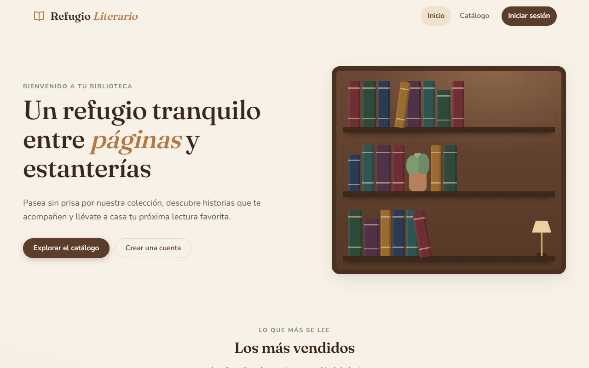
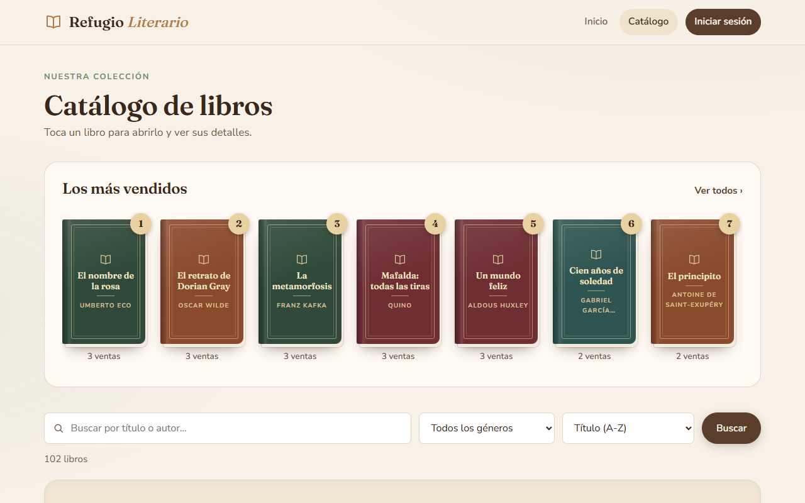
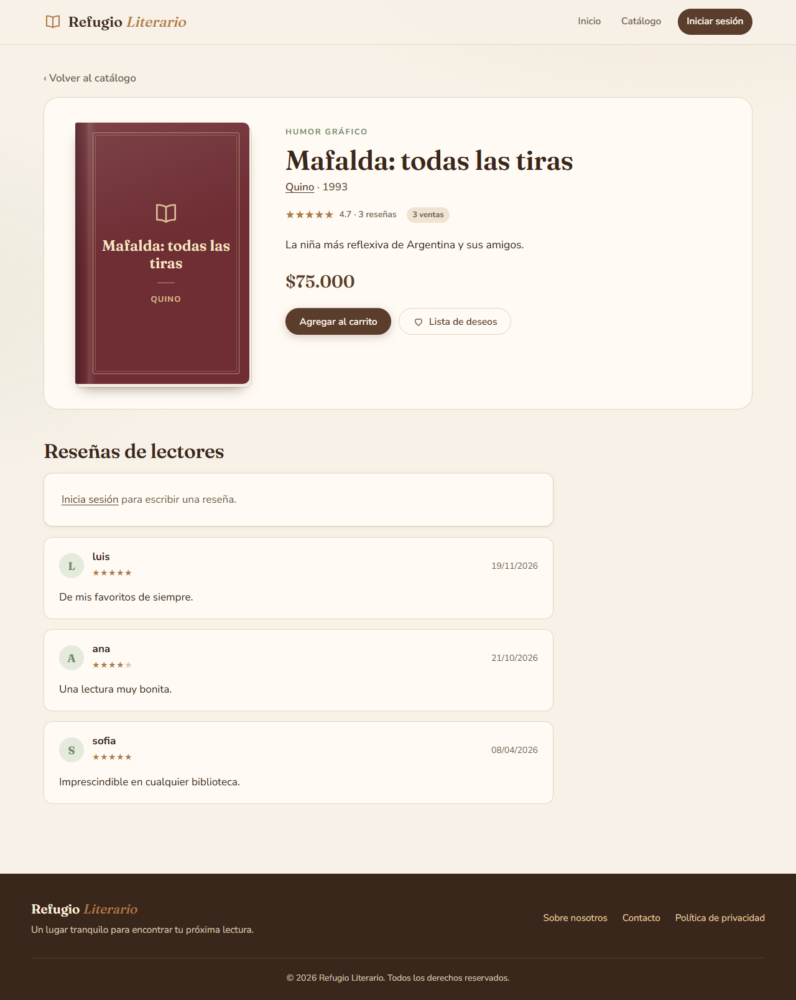
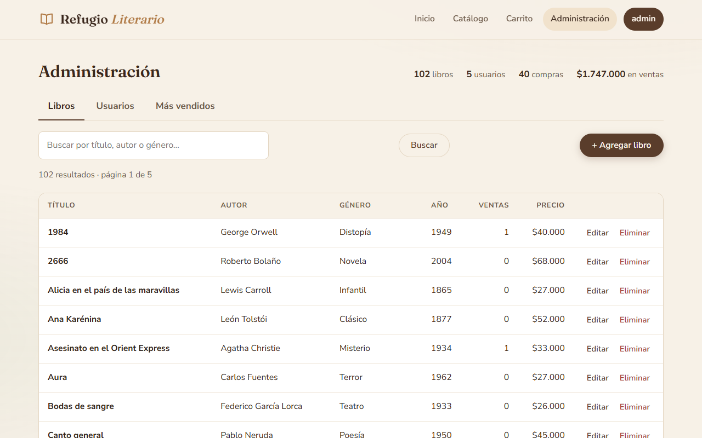
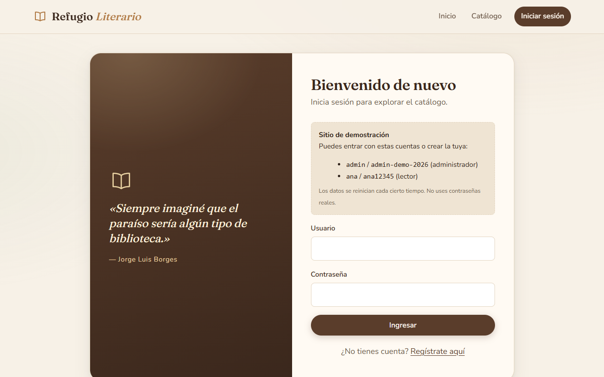
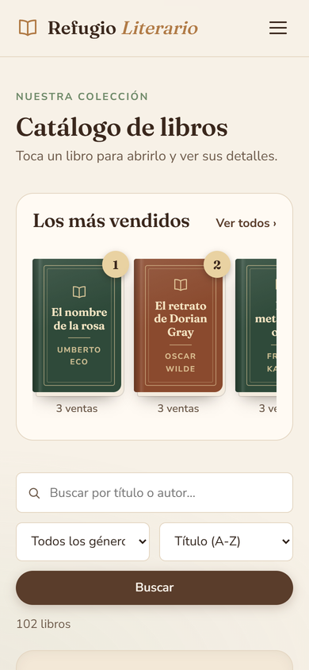

# Refugio Literario

Librería en línea hecha con Flask y SQLite: catálogo con búsqueda y filtros, carrito,
reseñas con estrellas, lista de deseos, libros más vendidos y panel de administración.

[](https://sonarcloud.io/summary/new_code?id=SBMICH_RefugioLiterario)
[](https://sonarcloud.io/summary/new_code?id=SBMICH_RefugioLiterario)

**Demo en vivo: [refugio-literario.onrender.com](https://refugio-literario.onrender.com)** · puede tardar alrededor de un minuto en despertar si nadie la usó recientemente.



| Catálogo con búsqueda, filtros y orden | Ficha del libro con reseñas |
|---|---|
|  |  |

| Panel de administración | Acceso con cuentas de demostración | Celular |
|---|---|---|
|  |  |  |

## Cómo ejecutarla

```bash
python3 -m venv venv
source venv/bin/activate        # En Windows: venv\Scripts\activate
pip install -r requirements.txt
python app.py
```

Abre http://127.0.0.1:5000. La base de datos (`libreria.db`) se crea sola la primera vez
a partir de `Base de datos/schema.sql`. Al crearla se muestran en la consola las contraseñas
iniciales de las cuentas (o se usa `ADMIN_PASSWORD` para la del administrador, si está definida).

Para cargar más libros, usuarios de prueba, compras y reseñas de ejemplo:

```bash
python herramientas/datos_ejemplo.py
```

Ese script crea usuarios de prueba con contraseñas conocidas (`ana`, `luis`, `sofia`). Solo se usa
en tu computador o en el sitio de demostración.

## Configuración en producción

| Variable | Para qué sirve |
|---|---|
| `SECRET_KEY` | Clave para firmar las sesiones. Si no se define, se genera una y se guarda en `.secret_key`. |
| `DATABASE_PATH` | Ruta del archivo SQLite (por defecto `libreria.db`). |
| `ADMIN_PASSWORD` | Contraseña de la cuenta `admin` cuando se crea la base. |
| `SESSION_COOKIE_SECURE=1` | Actívala cuando el sitio use HTTPS. |
| `TRUST_PROXY=1` | Actívala detrás de un proxy (Render, Railway...) para que el límite de intentos de inicio de sesión use la IP real de cada visitante. |
| `DEMO_MODE=1` | Sitio de demostración: muestra las cuentas de prueba en la página de acceso y no deja modificarlas ni eliminarlas. |

### Despliegue en Render

`render.yaml` describe el servicio: en Render, **New → Blueprint** y elegir este repositorio.
Pedirá la contraseña del administrador de la demo. La base SQLite está en el disco temporal del
servicio, así que **los datos se reinician** en cada despliegue o reinicio y se vuelven a cargar
los datos de ejemplo.

## Dependencias

`requirements.in` y `requirements-dev.in` listan lo que usa el proyecto. Los `.txt` son versiones
exactas con hashes, generadas así:

```bash
uv pip compile requirements.in --universal --python-version 3.10 --generate-hashes -o requirements.txt
uv pip compile requirements-dev.in --universal --python-version 3.10 --generate-hashes -o requirements-dev.txt
```

## Pruebas automáticas

```bash
pip install -r requirements-dev.txt
python -m pytest --cov=app
```

Cada prueba usa una base de datos temporal, así que no toca `libreria.db`. GitHub Actions
las ejecuta en cada push y envía la cobertura a SonarCloud.

## Prueba de carga

```bash
python herramientas/prueba_carga.py            # 10.000 libros y 50.000 compras
python herramientas/prueba_carga.py 50000 200000
```

Trabaja sobre una copia de la base de datos (o una nueva, si aún no existe) y muestra cuánto
tarda cada página.
